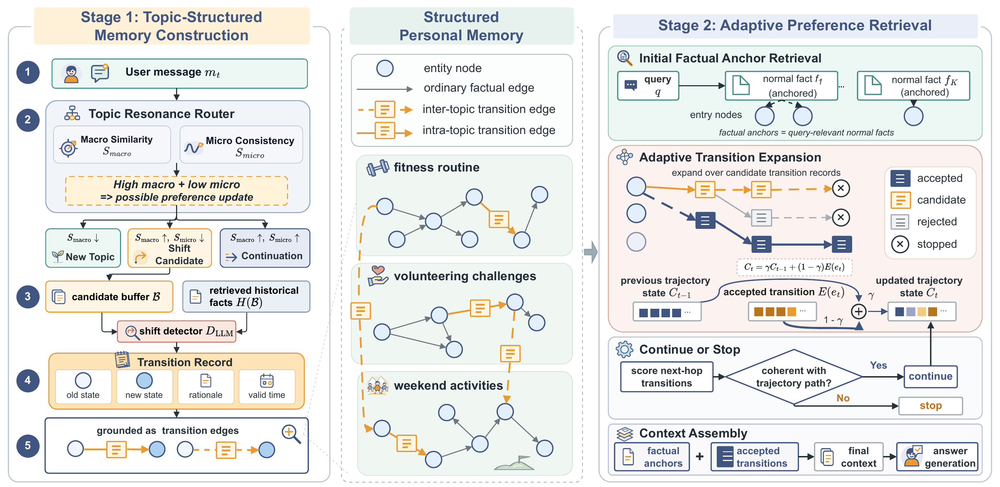

# TransMem

**TransMem: Transition-Aware Retrieval for Evolving Personal Memory**  
Accepted at **NeurIPS 2026**.

TransMem stores preference changes as explicit transition records alongside
ordinary facts. It organizes conversations into topic-structured memory graphs,
retrieves factual anchors, and adaptively follows relevant transitions to recover
how a user's preferences have evolved.



[Implementation details](docs/implementation.md) | [Service setup](docs/services.md)

This repository provides TransMem construction, retrieval, and evaluation on
the processed [PersonaMem](data/personamem/README.md).
Baseline reproductions and PersonaBench evaluation are not included.

## Installation

Clone the repository and install from its root:

```bash
git clone https://github.com/Aries-chen/TransMem.git
cd TransMem
conda create -n transmem python=3.10 -y
conda activate transmem
python -m pip install -e .
python -m spacy download en_core_web_sm
cp .env.example .env
```

## Configure Services

Start a Qwen generation server, a BGE-M3 embedding server, and a Neo4j instance.
Enter their endpoints and credentials in `.env`.
See [service setup](docs/services.md) for commands and configuration.

## Quick Start

With all three services running:

```bash
bash scripts/quickstart.sh
```

This small example follows a user's preference from swimming to cycling after
a pool closure and answers a question before and after the update.

## Run TransMem

```bash
bash scripts/run_full.sh --subset 32k --backbone qwen3-8b
```

## Citation

If you use TransMem, please cite:

```bibtex
@inproceedings{chen2026transmem,
  title     = {TransMem: Transition-Aware Retrieval for Evolving Personal Memory},
  author    = {Chen, Shigeng and Luo, Linhao and Shi, Changlong and Qiu, Zhangchi and Pan, Shirui},
  booktitle = {Advances in Neural Information Processing Systems},
  year      = {2026},
  note      = {Accepted; to appear}
}
```

## Acknowledgments and Licenses

Graph construction builds on [Graphiti](https://github.com/getzep/graphiti).
See [attribution and modifications](docs/implementation.md#third-party-notices).

Code: [Apache-2.0](LICENSE). PersonaMem data: [MIT](data/personamem/LICENSE).
